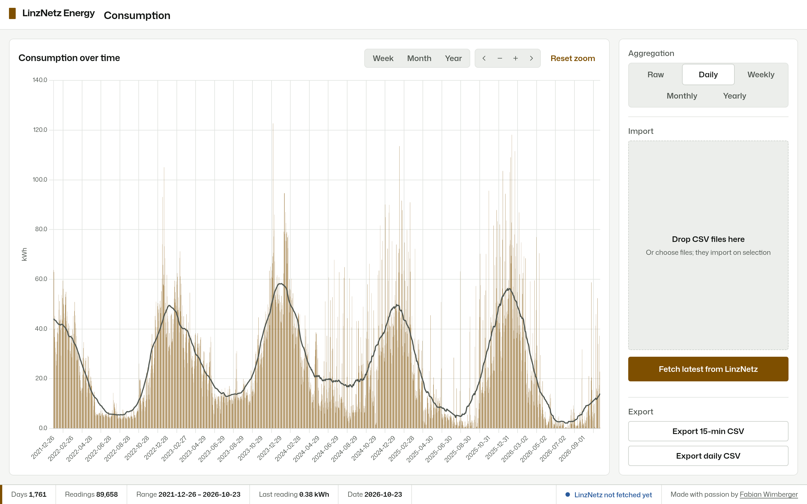
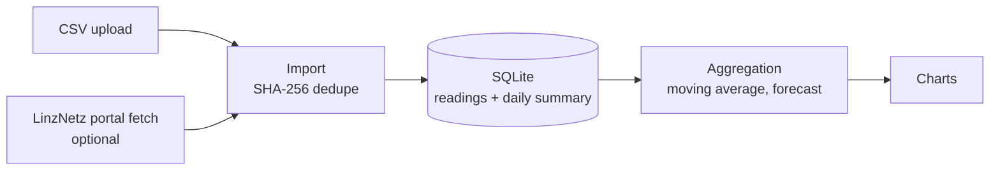

# LinzNetz Energy Tracker

[](https://github.com/fabianwimberger/linznetz-energy-tracker/actions)
[](https://codecov.io/gh/fabianwimberger/linznetz-energy-tracker)
[](https://github.com/fabianwimberger/linznetz-energy-tracker/pkgs/container/energy-tracker)
[](https://opensource.org/licenses/MIT)

> **⚠️ Disclaimer**: This is an independent, community-created project. It is **not affiliated with, endorsed by, or sponsored by Linz Netz GmbH**. "Linz Netz" and its associated logos are trademarks of Linz Netz GmbH. Use of the name is solely for identification and compatibility purposes. Use at your own risk.

A self-hosted dashboard for visualizing electricity consumption from Austrian
smart meter (Smart Meter / Intelligenter Zähler) CSV exports.

## Background

Austrian grid operators (Netzbetreiber) provide smart-meter data as raw CSV
files — either quarter-hourly intervals or daily totals. These exports are
accurate, but spotting trends or comparing seasons in a spreadsheet is tedious.
LinzNetz Energy Tracker imports the CSVs and gives you interactive charts with
moving averages and simple forecasts.

<p align="center">
  
  <br><em>Daily view with 90-day moving average and seasonal trends</em>
</p>

For live readings from a Smart Meter Adapter instead of CSV files, see
[SMA Energy Tracker](https://github.com/fabianwimberger/sma-energy-tracker).

## Features

- **Quarter-hourly raw view** with your average daily load pattern overlaid
- **Daily / weekly / monthly / yearly** aggregations with moving averages
- **Simple linear forecast** for the current week, month, or year
- **Duplicate import detection** via SHA-256 hashing
- **Handles both formats** from Austrian grid operators:
  - `Datum von / Datum bis / Energiemenge in kWh` (quarter-hourly)
  - `Datum / Energiemenge in kWh` (daily)
- **CSV export** — download quarter-hourly or daily data, re-importable as-is
- **SQLite** — no external database required

## Quick Start

```bash
git clone https://github.com/fabianwimberger/linznetz-energy-tracker.git
cd linznetz-energy-tracker
docker compose up -d
```

Open `http://localhost:8000` and upload a CSV. The pre-built image runs on AMD64 and ARM64. Tags: `latest`, `main`, `vX.Y.Z`, `vX.Y`, `vX`, and the short commit SHA.

Without Compose:

```bash
docker run -d \
  --name linznetz-energy-tracker \
  --restart unless-stopped \
  -p 8000:8000 \
  -v linznetz-energy-tracker-data:/app/data \
  -e TZ=Europe/Vienna \
  ghcr.io/fabianwimberger/linznetz-energy-tracker:latest
```

### Build from source

```bash
cp docker-compose.override.yml.example docker-compose.override.yml
make build
make up
```

## How It Works



Each file is hashed on import, so uploading the same export twice is a no-op.
Quarter-hourly readings are stored as-is and rolled up into a daily summary
table that the daily, weekly, monthly, and yearly views read from.

## Configuration

Environment variables; for Compose, copy `.env.example` to `.env`. The defaults work for a local deployment.

| Variable                 | Default           | Purpose                                                       |
| ------------------------ | ----------------- | ------------------------------------------------------------- |
| `PORT`                   | `8000`            | Host port for the web UI                                      |
| `TZ`                     | `Europe/Vienna`   | Container timezone                                            |
| `DATA_DIR`               | `/app/data`       | Directory for SQLite database and upload staging              |
| `DATABASE_URL`           | derived           | SQLAlchemy async URL (override to use a custom path)          |
| `STATIC_DIR`             | `/app/static`     | Directory served at `/static`                                 |
| `CORS_ORIGINS`           | `*`               | Comma-separated allowed origins                               |
| `LINZNETZ_USERNAME`      | unset             | Portal username; enables the "Fetch latest" button if set     |
| `LINZNETZ_PASSWORD`      | unset             | Portal password; required alongside `LINZNETZ_USERNAME`       |
| `LINZNETZ_LOOKBACK_DAYS` | `7`               | How many past days the fetch button checks for missing data   |

### Auto-fetch from the LinzNetz portal

If `LINZNETZ_USERNAME` and `LINZNETZ_PASSWORD` are set, the UI shows a
**Fetch latest from LinzNetz** button. It logs into the portal and
downloads quarter-hour CSVs for any day in the last `LINZNETZ_LOOKBACK_DAYS`
that doesn't yet have all 96 quarter-hour slots in the database, then
imports them. The portal often pushes partial days; those get re-fetched
on subsequent presses until complete. Days the portal hasn't published
yet are reported as skipped.

Credentials live only in the container's environment; they are not
persisted to disk or the database.

## Deployment

The app has no built-in authentication; put it behind a reverse proxy with auth before exposing it. [docs/deployment.md](docs/deployment.md) has a Traefik override example, and [docs/csv-format.md](docs/csv-format.md) describes the accepted CSV layouts and the export endpoint.

## Development

```bash
python -m venv .venv
.venv/bin/python -m pip install -e '.[dev]'
make setup        # Download vendor libraries
make test         # Run the test suite
make lint         # Run linters
make typecheck    # Run type checker
make format       # Format code

# Run locally
env DATA_DIR=./data STATIC_DIR=./static .venv/bin/python app.py
```

## License

MIT — see [LICENSE](LICENSE).

### Third-Party Licenses

| Component | License | Source |
|-----------|---------|--------|
| Chart.js | [MIT](https://github.com/chartjs/Chart.js/blob/master/LICENSE) | https://github.com/chartjs/Chart.js |
| chartjs-plugin-zoom | [MIT](https://github.com/chartjs/chartjs-plugin-zoom/blob/master/LICENSE) | https://github.com/chartjs/chartjs-plugin-zoom |
| Flatpickr | [MIT](https://github.com/flatpickr/flatpickr/blob/master/LICENSE.md) | https://github.com/flatpickr/flatpickr |
| Space Grotesk | [OFL-1.1](https://github.com/floriankarsten/space-grotesk/blob/master/OFL.txt) | https://github.com/floriankarsten/space-grotesk |
| IBM Plex Mono | [OFL-1.1](https://github.com/IBM/plex/blob/master/LICENSE.txt) | https://github.com/IBM/plex |
